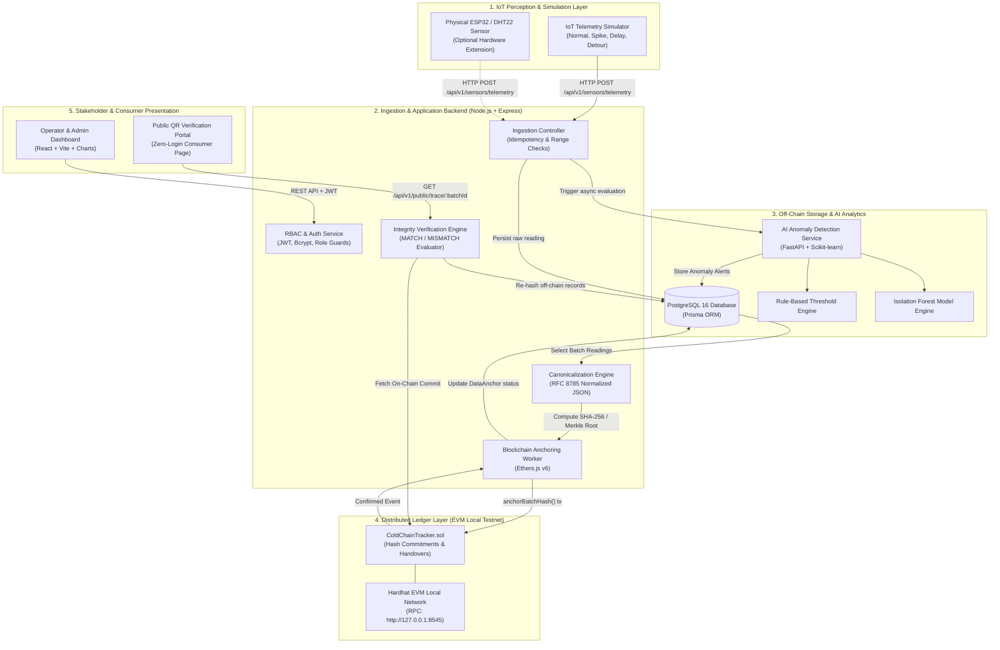
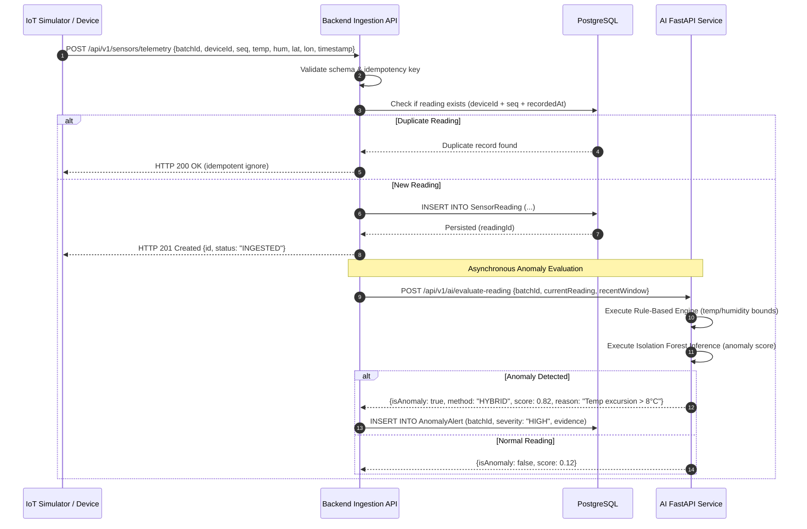
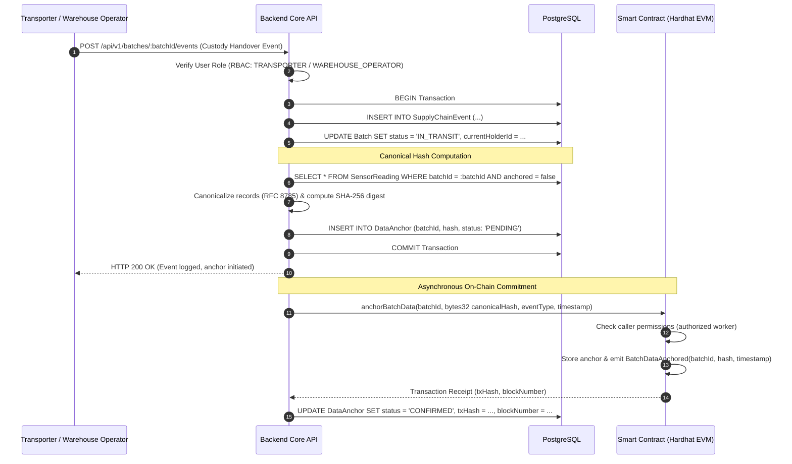
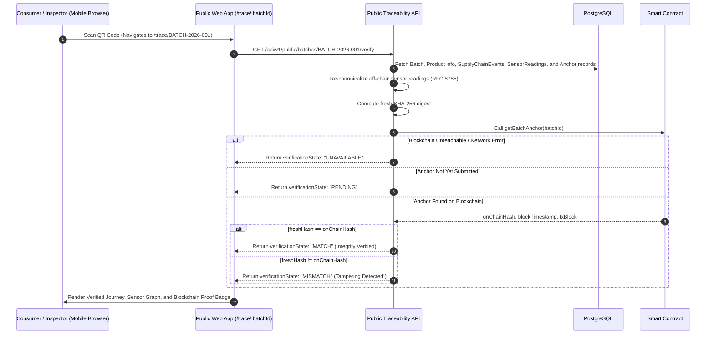

# System Architecture Specification

> **System**: Smart Cold-Chain Supply Chain Traceability System Using IoT, AI, and Blockchain  
> **Document**: Technical Architecture, Integration Protocols, and Sequence Models  
> **Status**: Approved Baseline

---

## 1. High-Level System Architecture

The system uses a **four-layer hybrid architecture** designed to solve the trade-off between IoT telemetry frequency and public/private blockchain transaction cost:
- High-frequency time-series telemetry is ingested and retained **off-chain** in a relational PostgreSQL database.
- Cryptographic fingerprints (canonical SHA-256 digests and Merkle Tree batch commitments) are anchored **on-chain** to provide tamper-evidence and non-repudiation.
- The AI service operates asynchronously over telemetry windows to flag violations without impeding real-time ingestion throughput.



---

## 2. Component Boundaries & Responsibilities

| Subsystem | Primary Responsibilities | Boundaries & Non-Goals |
| :--- | :--- | :--- |
| **IoT Simulator (`services/simulator`)** | Generates realistic, reproducible sensor readings (batchId, deviceId, sequenceNumber, temperature, humidity, coordinates). Emulates failure modes. | Does not talk directly to database or blockchain; sends standard HTTP JSON payloads. |
| **Backend API (`apps/api`)** | Validates payloads, enforces RBAC, computes RFC 8785 canonical hashes, manages database transactions, communicates with AI service and smart contract. | Does not train ML models; does not store sensitive keys in client-accessible responses. |
| **Database (`PostgreSQL`)** | Persists users, organizations, products, batches, sensor readings, anomaly alerts, anchors, and audit trails. | Enforces relational constraints; never stores plaintext passwords. |
| **AI Service (`services/ai`)** | Evaluates sensor windows against configurable threshold rules and scikit-learn Isolation Forest model; outputs anomaly scores and explanation metadata. | Does not alter database records directly; responds to REST requests from the backend API. |
| **Smart Contract (`contracts`)** | Records immutable cryptographic commitments (`bytes32` hash, batch ID, event type, timestamp, sender); emits indexing events. | Does not store raw sensor readings or personal identifiable information. |
| **Web Dashboard (`apps/web`)** | Provides visual monitoring, time-series charts, batch creation, handover tracking, alert management, and QR code generation. | Enforces route guards; relies on backend API for actual RBAC authorization. |
| **Public QR Portal (`apps/web`)** | Accessible without authentication; displays product journey, storage compliance, anomaly notices, and cryptographic integrity verification. | Restricts access to public batch metadata only; no internal user or system logs exposed. |

---

## 3. Core Sequence Models

### 3.1 Telemetry Ingestion and AI Anomaly Evaluation Flow



---

### 3.2 Custody Handover & Cryptographic Anchoring Flow



---

### 3.3 Public QR Code Scan & Hash Integrity Verification Flow



---

## 4. Cryptographic Integrity Specification

### 4.1 Canonical Data Format (RFC 8785)
To ensure identical input yields identical SHA-256 hashes across different platforms, sensor readings are serialized into Canonical JSON:
1. **Key Ordering**: All object keys sorted lexicographically by UTF-16 code units.
2. **Whitespace**: No whitespace outside of string literals (compact serialization).
3. **Number Formatting**: Decimals serialized with fixed precision (e.g. 2 decimal places for temperature and humidity: `4.50`).
4. **Timestamp Standardization**: UTC ISO-8601 strings ending in `Z` with millisecond precision: `YYYY-MM-DDTHH:mm:ss.sssZ`.
5. **Character Encoding**: Strict UTF-8.

#### Canonical Telemetry Object Example:
```json
{"batchId":"BATCH-2026-001","deviceId":"DEV-COLD-01","humidityPercent":65.20,"latitude":10.7626,"longitude":106.6601,"recordedAt":"2026-10-17T13:30:00.000Z","sequenceNumber":101,"temperatureC":4.20}
```
**Canonical Digest**: `SHA-256(canonical_bytes)` -> `0x3a7b9c...` (`bytes32`).

### 4.2 Verification State Machine

```
      +-----------------------------+
      |      Compute Fresh Hash     |
      +-----------------------------+
                     |
                     v
      +-----------------------------+
      |  Fetch On-Chain Commitment  |
      +-----------------------------+
        /            |            \
       /             |             \
[RPC Offline]   [Not Found]    [Found Hash]
      |              |              |
      v              v              v
+-----------+  +-----------+        |
|UNAVAILABLE|  |  PENDING  |        |
+-----------+  +-----------+        |
                                    v
                     +-----------------------------+
                     | Does Fresh Hash == On-Chain?|
                     +-----------------------------+
                                /         \
                             [Yes]        [No]
                              /             \
                             v               v
                      +-----------+    +-----------+
                      |   MATCH   |    | MISMATCH  |
                      | (Intact)  |    | (Tampered)|
                      +-----------+    +-----------+
```

---

## 5. Smart Contract Design (`ColdChainTracker.sol`)

### 5.1 Storage Structures
```solidity
// SPDX-License-Identifier: MIT
pragma solidity ^0.8.24;

contract ColdChainTracker {
    enum EventType { CREATED, DISPATCHED, IN_TRANSIT, HANDOVER, DELIVERED, ALERT }

    struct AnchorRecord {
        bytes32 dataHash;       // SHA-256 canonical digest or Merkle Root
        uint256 timestamp;      // Block timestamp of commitment
        address submitter;      // Authorized account that anchored the hash
        uint32 readingCount;    // Number of telemetry records encapsulated
        string schemaVersion;   // E.g., "1.0.0"
        bool exists;
    }

    struct CustodyEvent {
        bytes32 batchId;
        EventType eventType;
        string location;
        address fromActor;
        address toActor;
        uint256 timestamp;
    }

    // batchId => latest AnchorRecord
    mapping(bytes32 => AnchorRecord) public batchAnchors;
    // batchId => array of custody handover events
    mapping(bytes32 => CustodyEvent[]) public batchEvents;

    event BatchDataAnchored(bytes32 indexed batchId, bytes32 indexed dataHash, address indexed submitter, uint256 timestamp);
    event CustodyTransferred(bytes32 indexed batchId, EventType eventType, address indexed fromActor, address indexed toActor, uint256 timestamp);
}
```

---

## 6. Security & Threat Model

1. **Tampering in Transit (Database Injection)**: An attacker who modifies database values will alter the freshly computed hash. The next verification against `ColdChainTracker.sol` immediately produces `MISMATCH`.
2. **Replay / Duplicate Sensor Attacks**: The ingestion API enforces unique index constraints `(deviceId, sequenceNumber, recordedAt)`. Duplicated packets are dropped or acknowledged idempotently without distorting history.
3. **Privilege Escalation**: Backend endpoints enforce token authentication with role-based checks. Even if a user crafts a valid JWT, their role must have permission for the specific action (`PRODUCER` can create batches; only `ADMIN` can register new devices).
4. **Physical Oracle Limitation (Acknowledged Principle)**: Cryptographic verification guarantees that the off-chain records are **identical to what was anchored at time $T$**. It does **not** prove the physical DHT22 sensor was calibrated truthfully. This limitation is prominently surfaced in the UI and academic reporting.
