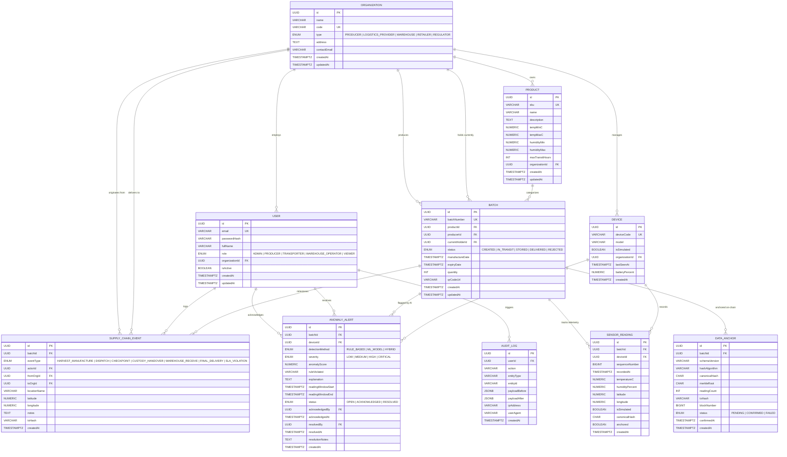

# Cold-Chain Database Entity Relationship Diagram (ERD)

This document specifies the PostgreSQL relational data model for the **Smart Cold-Chain Traceability System**, managed via Prisma ORM.

---

## 1. Entity-Relationship Overview

---

## 2. Relational Schema Details & Constraints

### 2.1 Core Entities & Primary Keys
All entities use universally unique identifiers (UUID v4) as synthetic primary keys (`@id @default(uuid())`). Natural business keys (`code`, `email`, `sku`, `batchNumber`, `deviceCode`) are declared as `UNIQUE`.

### 2.2 Traceability & Foreign Key Integrity
- **Batches**:
  - `productId -> Product.id` (`onDelete: Restrict`): Products cannot be deleted if active batches exist.
  - `producerId -> Organization.id` (`onDelete: Restrict`): Producer orgs cannot be purged while batch records exist.
  - `currentHolderId -> Organization.id` (`onDelete: Restrict`): Current custodian organization is required.
- **SensorReadings**:
  - `batchId -> Batch.id` (`onDelete: Cascade`): Traceability telemetry is tied to batch lifecycle.
  - `deviceId -> Device.id` (`onDelete: Cascade`): Tied to originating device.
  - **Unique Idempotency Constraint**: `@@unique([deviceId, sequenceNumber, recordedAt], name: "idx_reading_idempotency")` guarantees that telemetry packets sent over unstable networks cannot be duplicated.
- **SupplyChainEvents**:
  - `batchId -> Batch.id` (`onDelete: Cascade`)
  - `actorId -> User.id` (`onDelete: SetNull`)
  - `fromOrgId, toOrgId -> Organization.id` (`onDelete: SetNull`)
- **AnomalyAlerts**:
  - `batchId -> Batch.id` (`onDelete: Cascade`)
  - `deviceId -> Device.id` (`onDelete: SetNull`)
  - `acknowledgedBy, resolvedBy -> User.id` (`onDelete: SetNull`)
- **DataAnchors**:
  - `batchId -> Batch.id` (`onDelete: Cascade`)
  - Tracks `hashAlgorithm` (default `SHA-256`), `canonicalHash`, `merkleRoot`, `txHash`, and `blockNumber`.

---

## 3. Indexing Strategy

| Table | Index Columns | Purpose |
| :--- | :--- | :--- |
| `batches` | `productId`, `status` | Fast filtering on catalog & logistics dashboard |
| `sensor_readings` | `[deviceId, sequenceNumber, recordedAt]` (UNIQUE) | Strict ingestion idempotency |
| `sensor_readings` | `[batchId, recordedAt DESC]` | Ultra-fast time-series queries for charts & AI analysis |
| `supply_chain_events` | `[batchId, createdAt]` | Chronological audit trail and timeline generation |
| `anomaly_alerts` | `[batchId, status]` | Filtering unresolved cold-chain incidents per batch |
| `data_anchors` | `[batchId, createdAt DESC]` | Efficient on-chain anchoring verification & proof lookup |
| `audit_logs` | `[entityType, entityId]`, `[createdAt]` | Compliance and forensic query acceleration |

---

## 4. Timestamps & Enums
- All timestamps use PostgreSQL `TIMESTAMPTZ(6)` to guarantee explicit UTC storage and timezone awareness.
- Domain enums guarantee type safety across API and database: `UserRole`, `OrganizationType`, `BatchStatus`, `EventType`, `DetectionMethod`, `AlertSeverity`, `AlertStatus`, `AnchorStatus`.
