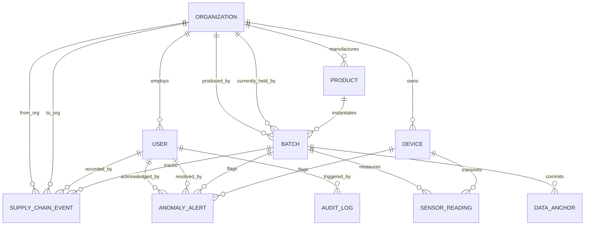

# Data Model Specification

> **System**: Smart Cold-Chain Supply Chain Traceability System  
> **Document**: Relational Schema, Entities, Enums, Constraints, and Indexes  
> **ORM Engine**: Prisma ORM with PostgreSQL 16

---

## 1. Entity-Relationship Overview

---

## 2. Enumerations

### 2.1 UserRole
- `ADMIN`: Full administrative control over users, organizations, devices, and system settings.
- `PRODUCER`: Can register products, create traceability batches, and initiate shipment.
- `TRANSPORTER`: Can record transport checkpoints, route telemetry, and custody transfers.
- `WAREHOUSE_OPERATOR`: Can log warehouse receiving, environmental storage checks, and dispatch.
- `VIEWER`: Read-only access to internal telemetry, alerts, and reports.
*(Note: Consumers/Public visitors access batches via unauthenticated public route `/api/v1/public/batches/:batchNumber`)*

### 2.2 OrganizationType
- `PRODUCER`: Pharmaceutical lab, agriculture farm, or food manufacturing plant.
- `LOGISTICS_PROVIDER`: Cold-chain freight carrier or fleet operator.
- `WAREHOUSE`: Cold-storage distribution center.
- `RETAILER`: Pharmacy, supermarket, or medical clinic.
- `REGULATOR`: Food & drug inspection agency.

### 2.3 BatchStatus
- `CREATED`: Batch registered and labeled; awaiting initial dispatch.
- `IN_TRANSIT`: Under custody of a logistics transporter.
- `STORED`: Located inside a controlled cold-storage warehouse.
- `DELIVERED`: Successfully arrived at destination retail/medical site.
- `REJECTED`: Flagged as spoiled, degraded, or violated beyond permitted tolerances.

### 2.4 EventType
- `HARVEST_MANUFACTURE`: Batch production and packaging.
- `DISPATCH`: Departure from origin facility.
- `CHECKPOINT`: Transit checkpoint or toll gate scan.
- `CUSTODY_HANDOVER`: Legal and physical transfer between organizations.
- `WAREHOUSE_RECEIVE`: Entry into temperature-controlled storage.
- `FINAL_DELIVERY`: Handover to final pharmacy/retailer.
- `SLA_VIOLATION`: Formal logging of cold-chain break.

### 2.5 DetectionMethod
- `RULE_BASED`: Deterministic threshold violations (min/max temp, max duration, sudden spike).
- `ML_MODEL`: Unsupervised machine learning (Isolation Forest anomaly score).
- `HYBRID`: Corroborated by both threshold breach and high ML anomaly score.

### 2.6 AlertSeverity
- `LOW`: Minor deviation within acceptable buffer.
- `MEDIUM`: Moderate excursion or unusual duration.
- `HIGH`: Severe thermal violation likely compromising shelf life.
- `CRITICAL`: Prolonged thermal abuse or tampering indication requiring batch quarantine.

### 2.7 AlertStatus
- `OPEN`: Newly detected anomaly; awaiting review.
- `ACKNOWLEDGED`: Recognized by an operator; investigation underway.
- `RESOLVED`: Handled, justified, or batch marked as quarantined.

### 2.8 AnchorStatus
- `PENDING`: Hash generated and submitted to blockchain mempool.
- `CONFIRMED`: Transaction confirmed in a mined block.
- `FAILED`: Transaction reverted or RPC error occurred.

---

## 3. Entity Specifications

### 3.1 Organization
| Column | Type | Constraints | Description |
| :--- | :--- | :--- | :--- |
| `id` | UUID | Primary Key | Unique organization identifier |
| `name` | VARCHAR(120) | NOT NULL | Registered business name |
| `code` | VARCHAR(50) | UNIQUE, NOT NULL | E.g. `ORG-PHARMA-01` |
| `type` | OrganizationType | NOT NULL | Organization category |
| `address` | TEXT | NULLABLE | Physical operating facility address |
| `contactEmail`| VARCHAR(120) | NOT NULL | Operations email |
| `createdAt` | TIMESTAMPTZ | NOT NULL, DEFAULT now() | Record creation timestamp |
| `updatedAt` | TIMESTAMPTZ | NOT NULL | Last update timestamp |

### 3.2 User
| Column | Type | Constraints | Description |
| :--- | :--- | :--- | :--- |
| `id` | UUID | Primary Key | Unique user identifier |
| `email` | VARCHAR(120) | UNIQUE, NOT NULL | Login email address |
| `passwordHash`| VARCHAR(255) | NOT NULL | Argon2 / Bcrypt password hash |
| `fullName` | VARCHAR(120) | NOT NULL | User display name |
| `role` | UserRole | NOT NULL, DEFAULT 'VIEWER' | Assigned RBAC role |
| `organizationId`| UUID | FK -> Organization.id | Affiliated organization |
| `isActive` | BOOLEAN | NOT NULL, DEFAULT true | Account active flag |
| `createdAt` | TIMESTAMPTZ | NOT NULL, DEFAULT now() | Registration date |
| `updatedAt` | TIMESTAMPTZ | NOT NULL | Last update date |

### 3.3 Product
| Column | Type | Constraints | Description |
| :--- | :--- | :--- | :--- |
| `id` | UUID | Primary Key | Unique product catalog ID |
| `sku` | VARCHAR(60) | UNIQUE, NOT NULL | Stock Keeping Unit |
| `name` | VARCHAR(150) | NOT NULL | Product commercial name |
| `description` | TEXT | NULLABLE | Product characteristics and handling guidelines |
| `tempMinC` | NUMERIC(5,2) | NOT NULL | Minimum acceptable temperature (°C), e.g. 2.00 |
| `tempMaxC` | NUMERIC(5,2) | NOT NULL | Maximum acceptable temperature (°C), e.g. 8.00 |
| `humidityMin` | NUMERIC(5,2) | NULLABLE | Minimum humidity (%), e.g. 40.00 |
| `humidityMax` | NUMERIC(5,2) | NULLABLE | Maximum humidity (%), e.g. 70.00 |
| `maxTransitHours`| INT | NULLABLE | Maximum allowable transit hours before inspection |
| `organizationId`| UUID | FK -> Organization.id | Manufacturer / Producer |
| `createdAt` | TIMESTAMPTZ | NOT NULL, DEFAULT now() | Catalog entry date |

### 3.4 Batch
| Column | Type | Constraints | Description |
| :--- | :--- | :--- | :--- |
| `id` | UUID | Primary Key | Internal surrogate identifier |
| `batchNumber` | VARCHAR(64) | UNIQUE, NOT NULL | Business traceability number (e.g. `BATCH-VAX-2026-001`) |
| `productId` | UUID | FK -> Product.id | Linked product specification |
| `producerId` | UUID | FK -> Organization.id | Manufacturing organization |
| `currentHolderId`| UUID | FK -> Organization.id | Current physical custodian |
| `status` | BatchStatus | NOT NULL, DEFAULT 'CREATED'| Current lifecycle state |
| `manufactureDate`| TIMESTAMPTZ | NOT NULL | Manufacturing date |
| `expiryDate` | TIMESTAMPTZ | NOT NULL | Product expiration date |
| `quantity` | INT | NOT NULL | Units produced |
| `qrCodeUrl` | VARCHAR(255) | NULLABLE | Stable public verification link |
| `createdAt` | TIMESTAMPTZ | NOT NULL, DEFAULT now() | Record creation date |
| `updatedAt` | TIMESTAMPTZ | NOT NULL | Last status update |

### 3.5 Device
| Column | Type | Constraints | Description |
| :--- | :--- | :--- | :--- |
| `id` | UUID | Primary Key | Device record identifier |
| `deviceCode` | VARCHAR(60) | UNIQUE, NOT NULL | Hardware identifier (e.g. `DEV-SIM-TRUCK-01`) |
| `model` | VARCHAR(80) | NOT NULL | Hardware / simulator profile |
| `isSimulated` | BOOLEAN | NOT NULL, DEFAULT true | Simulator vs Physical hardware indicator |
| `organizationId`| UUID | FK -> Organization.id | Owner organization |
| `lastSeenAt` | TIMESTAMPTZ | NULLABLE | Last received heartbeat / telemetry timestamp |
| `batteryPercent`| NUMERIC(5,2) | NULLABLE | Telemetry power level |
| `createdAt` | TIMESTAMPTZ | NOT NULL, DEFAULT now() | Registration date |

### 3.6 SensorReading
| Column | Type | Constraints | Description |
| :--- | :--- | :--- | :--- |
| `id` | UUID | Primary Key | Unique reading identifier |
| `batchId` | UUID | FK -> Batch.id, INDEX | Target batch |
| `deviceId` | UUID | FK -> Device.id, INDEX | Telemetry source device |
| `sequenceNumber`| BIGINT | NOT NULL | Monotonic packet counter |
| `recordedAt` | TIMESTAMPTZ | NOT NULL, INDEX | Exact physical capture timestamp (UTC) |
| `temperatureC` | NUMERIC(5,2) | NOT NULL | Recorded temperature in Celsius |
| `humidityPercent`| NUMERIC(5,2)| NULLABLE | Recorded relative humidity percentage |
| `latitude` | NUMERIC(9,6) | NULLABLE | GPS latitude coordinate |
| `longitude` | NUMERIC(9,6) | NULLABLE | GPS longitude coordinate |
| `isSimulated` | BOOLEAN | NOT NULL, DEFAULT true | Data origin flag |
| `canonicalHash`| CHAR(64) | NULLABLE | SHA-256 digest of normalized single reading |
| `anchored` | BOOLEAN | NOT NULL, DEFAULT false | Whether included in a confirmed on-chain commitment |
| `createdAt` | TIMESTAMPTZ | NOT NULL, DEFAULT now() | Database arrival timestamp |

*Unique Constraint*: `UNIQUE (deviceId, sequenceNumber, recordedAt)` (Idempotency guarantee).

### 3.7 SupplyChainEvent
| Column | Type | Constraints | Description |
| :--- | :--- | :--- | :--- |
| `id` | UUID | Primary Key | Unique event identifier |
| `batchId` | UUID | FK -> Batch.id, INDEX | Linked batch |
| `eventType` | EventType | NOT NULL | Lifecycle transition type |
| `actorId` | UUID | FK -> User.id | Performing operator |
| `fromOrgId` | UUID | FK -> Organization.id | Releasing organization |
| `toOrgId` | UUID | FK -> Organization.id | Receiving organization |
| `locationName`| VARCHAR(150) | NOT NULL | Facility or route checkpoint name |
| `latitude` | NUMERIC(9,6) | NULLABLE | Event geographic coordinate |
| `longitude` | NUMERIC(9,6) | NULLABLE | Event geographic coordinate |
| `notes` | TEXT | NULLABLE | Operational remarks or handover details |
| `txHash` | VARCHAR(66) | NULLABLE | Blockchain transaction hash if anchored |
| `createdAt` | TIMESTAMPTZ | NOT NULL, DEFAULT now() | Event timestamp |

### 3.8 AnomalyAlert
| Column | Type | Constraints | Description |
| :--- | :--- | :--- | :--- |
| `id` | UUID | Primary Key | Unique alert identifier |
| `batchId` | UUID | FK -> Batch.id, INDEX | Target batch |
| `deviceId` | UUID | FK -> Device.id | Source telemetry device |
| `detectionMethod`| DetectionMethod | NOT NULL | Rule-based, ML model, or Hybrid |
| `severity` | AlertSeverity | NOT NULL | Alert gravity |
| `anomalyScore` | NUMERIC(5,4) | NULLABLE | ML anomaly score (e.g. 0.8540) |
| `ruleViolated` | VARCHAR(120) | NULLABLE | Name of threshold rule triggered |
| `explanation` | TEXT | NOT NULL | Human-readable root-cause explanation |
| `readingWindowStart`| TIMESTAMPTZ | NOT NULL | Start of anomalous telemetry window |
| `readingWindowEnd`| TIMESTAMPTZ | NOT NULL | End of anomalous telemetry window |
| `status` | AlertStatus | NOT NULL, DEFAULT 'OPEN'| Resolution workflow status |
| `acknowledgedBy`| UUID | FK -> User.id, NULLABLE| Operator who acknowledged |
| `acknowledgedAt`| TIMESTAMPTZ | NULLABLE | Acknowledgement timestamp |
| `resolvedBy` | UUID | FK -> User.id, NULLABLE| Operator who resolved |
| `resolvedAt` | TIMESTAMPTZ | NULLABLE | Resolution timestamp |
| `resolutionNotes`| TEXT | NULLABLE | Operator rationale for resolution |
| `createdAt` | TIMESTAMPTZ | NOT NULL, DEFAULT now() | Detection timestamp |

### 3.9 DataAnchor
| Column | Type | Constraints | Description |
| :--- | :--- | :--- | :--- |
| `id` | UUID | Primary Key | Unique anchor record identifier |
| `batchId` | UUID | FK -> Batch.id, INDEX | Target batch |
| `schemaVersion`| VARCHAR(20) | NOT NULL, DEFAULT '1.0.0' | Canonical serialization schema version |
| `canonicalHash`| CHAR(64) | NOT NULL | Computed SHA-256 digest (hex) |
| `merkleRoot` | CHAR(64) | NULLABLE | Merkle root if multiple readings aggregated |
| `readingCount`| INT | NOT NULL | Total sensor readings committed |
| `txHash` | VARCHAR(66) | NULLABLE, INDEX | EVM transaction hash (`0x...`) |
| `blockNumber` | BIGINT | NULLABLE | Block height where tx was mined |
| `status` | AnchorStatus | NOT NULL, DEFAULT 'PENDING'| Commitment lifecycle state |
| `confirmedAt` | TIMESTAMPTZ | NULLABLE | Confirmation timestamp |
| `createdAt` | TIMESTAMPTZ | NOT NULL, DEFAULT now() | Anchor creation timestamp |

### 3.10 AuditLog
| Column | Type | Constraints | Description |
| :--- | :--- | :--- | :--- |
| `id` | UUID | Primary Key | Unique log identifier |
| `userId` | UUID | FK -> User.id, NULLABLE| Actor performing action (null for system) |
| `action` | VARCHAR(100) | NOT NULL | Action verb (e.g. `BATCH_CREATED`, `ALERT_RESOLVED`) |
| `entityType` | VARCHAR(60) | NOT NULL | Target entity table |
| `entityId` | VARCHAR(64) | NOT NULL | Target entity ID |
| `payloadBefore`| JSONB | NULLABLE | Snapshot prior to modification |
| `payloadAfter` | JSONB | NULLABLE | Snapshot post modification |
| `ipAddress` | VARCHAR(45) | NULLABLE | Request IP address |
| `userAgent` | VARCHAR(255) | NULLABLE | Client browser / device signature |
| `createdAt` | TIMESTAMPTZ | NOT NULL, DEFAULT now() | Log timestamp |

---

## 4. Indexing & Query Optimization Strategy

1. **High-Frequency Ingestion**:
   - `CREATE UNIQUE INDEX idx_reading_idempotency ON "SensorReading" ("deviceId", "sequenceNumber", "recordedAt");`
   - Prevents duplicate packets when IoT devices retry due to network loss.
2. **Dashboard Time-Series Queries**:
   - `CREATE INDEX idx_reading_batch_time ON "SensorReading" ("batchId", "recordedAt" DESC);`
   - Accelerates fetching recent telemetry windows for live charts.
3. **Public QR Code Resolution**:
   - `CREATE UNIQUE INDEX idx_batch_number ON "Batch" ("batchNumber");`
   - Instant O(1) batch lookup when scanning QR code.
4. **Blockchain Verification**:
   - `CREATE INDEX idx_anchor_batch ON "DataAnchor" ("batchId", "createdAt" DESC);`
   - Fast retrieval of the most recent committed state.
