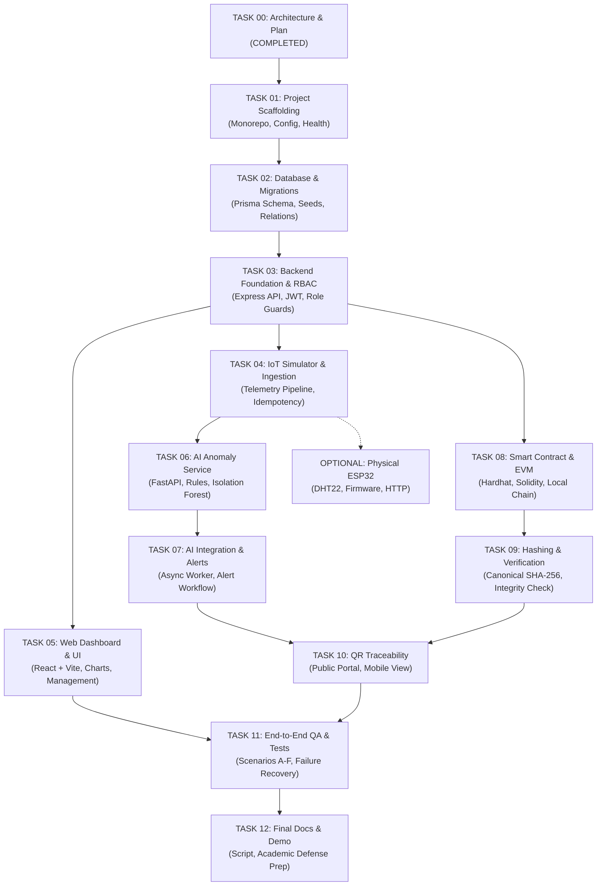

# Implementation Roadmap & Task Dependencies

> **System**: Smart Cold-Chain Supply Chain Traceability System  
> **Document**: Phased Execution Plan, Dependency Graph, and Quality Gates  
> **Reference**: Aligned with `task.md` and Master Prompt

---

## 1. Task Dependency Graph

---

## 2. Phase-by-Phase Task Specifications

### Phase 1: Architectural Foundation & Scaffolding
- **TASK 00 — Repository Audit & Implementation Plan** *(Current Task)*
  - **Prerequisites**: Master Prompt.
  - **Deliverables**: `docs/PROJECT_PLAN.md`, `docs/ARCHITECTURE.md`, `docs/DATA_MODEL.md`, `docs/IMPLEMENTATION_ROADMAP.md`.
  - **Acceptance Criteria**: Approved specifications; no application code prematurely implemented.
- **TASK 01 — Project Scaffolding**
  - **Prerequisites**: Task 00 approved.
  - **Objectives**: Setup monorepo workspace (`apps/web`, `apps/api`, `services/ai`, `contracts`, `infra`, `docs`), root `package.json`, `.gitignore`, `.env.example`, `docker-compose.yml`, TypeScript configs, and health check endpoints.
  - **Verification**: `npm install` runs cleanly; backend `/health` and AI `/health` respond 200 OK.

### Phase 2: Relational Persistence & Core Business API
- **TASK 02 — Database and Migrations**
  - **Prerequisites**: Task 01.
  - **Objectives**: Implement Prisma schema with PostgreSQL 16 based on `DATA_MODEL.md`; write deterministic seed script with mock organizations, users, products, and batches.
  - **Verification**: `npx prisma migrate dev` creates tables; `npx prisma db seed` seeds database without errors.
- **TASK 03 — Backend Foundation and RBAC**
  - **Prerequisites**: Task 02.
  - **Objectives**: Implement authentication routes (login), JWT issuance, argon2/bcrypt password verification, RBAC middleware (`ADMIN`, `PRODUCER`, `TRANSPORTER`, `WAREHOUSE_OPERATOR`, `VIEWER`), and core entity CRUD controllers.
  - **Verification**: Integration tests verify that unauthorized roles receive HTTP 403 Forbidden.

### Phase 3: Telemetry Pipeline & Presentation Layer
- **TASK 04 — IoT Simulator and Sensor Ingestion**
  - **Prerequisites**: Task 03.
  - **Objectives**: Build configurable simulator (`services/simulator`) emitting normal and anomaly scenarios; implement backend ingestion endpoint `/api/v1/sensors/telemetry` with idempotency deduplication.
  - **Verification**: Simulated telemetry streams into PostgreSQL; duplicates are acknowledged idempotently.
- **TASK 05 — Web Dashboard and Traceability UI**
  - **Prerequisites**: Task 03 & 04.
  - **Objectives**: Build React + TypeScript + Vite dashboard with time-series charts (Recharts), batch detail views, timeline stepper, and alert lists.
  - **Verification**: UI displays live database telemetry; responsive layout verified.

### Phase 4: Machine Learning & Anomaly Evaluation
- **TASK 06 — AI Anomaly Detection Service**
  - **Prerequisites**: Task 04.
  - **Objectives**: Build Python FastAPI service; implement deterministic threshold violation rules and Scikit-learn Isolation Forest model; train on reproducible synthetic dataset; persist model artifact.
  - **Verification**: Pytest test suite validates detection of temperature excursions and synthetic anomalies.
- **TASK 07 — AI Integration and Alert Workflow**
  - **Prerequisites**: Task 05 & 06.
  - **Objectives**: Integrate backend API with FastAPI service; persist `AnomalyAlert` records; support operator acknowledgement and resolution workflow.
  - **Verification**: Real-time alerts populate operator dashboard when simulator breaches temperature boundaries.

### Phase 5: Cryptographic Integrity & Blockchain Anchoring
- **TASK 08 — Smart Contract and Local Blockchain**
  - **Prerequisites**: Task 01.
  - **Objectives**: Implement `ColdChainTracker.sol` with Hardhat; test hash anchoring, custody event logging, and access control.
  - **Verification**: Hardhat unit test suite passes with 100% contract coverage.
- **TASK 09 — Hashing, Anchoring and Integrity Verification**
  - **Prerequisites**: Task 07 & 08.
  - **Objectives**: Implement RFC 8785 canonical JSON serialization and SHA-256 computation; background worker submitting anchors to EVM; verification endpoint returning `MATCH`, `MISMATCH`, `PENDING`, or `UNAVAILABLE`.
  - **Verification**: Controlled tampering of a sensor record in DB instantly causes verification state to flip to `MISMATCH`.

### Phase 6: Public Verification & Final Polish
- **TASK 10 — QR Traceability and Supply-Chain Timeline**
  - **Prerequisites**: Task 05 & 09.
  - **Objectives**: Public QR code generation; unauthenticated public consumer page `/trace/:batchNumber` displaying batch journey, sensor health summary, and cryptographic verification badge.
  - **Verification**: Direct scan or URL open displays verified batch data without leaking internal operator data.
- **TASK 11 — End-to-End Integration and QA**
  - **Prerequisites**: All previous tasks.
  - **Objectives**: Run end-to-end audit covering scenarios A–F (normal shipment, thermal excursion, DB tampering, unauthorized access, RPC failure, QR verification).
  - **Verification**: Automated test runners across all services pass.
- **TASK 12 — Final Documentation and Demonstration**
  - **Prerequisites**: Task 11.
  - **Objectives**: Complete presentation script, architecture guide, demo video instructions, and academic defense Q&A.
- **OPTIONAL TASK — ESP32 Sensor Integration**
  - **Objectives**: Physical hardware firmware (C++ / Arduino framework) sending authenticated telemetry to `/api/v1/sensors/telemetry`.

---

## 3. Definition of Done Checklist

| Criterion | Target Metric | Status |
| :--- | :--- | :---: |
| **Startup Documentation** | Single-command setup via Docker Compose & npm | Pending Task 01 |
| **Database Migrations** | Clean migration and seed repeatability | Pending Task 02 |
| **RBAC Security** | 100% protected endpoints guarded server-side | Pending Task 03 |
| **Telemetry Ingestion** | Zero data loss under simulated retry bursts | Pending Task 04 |
| **Operator UI** | Rich time-series charts & timeline stepper | Pending Task 05 |
| **AI Evaluation** | Isolation Forest + Explainable Threshold rules | Pending Task 06-07 |
| **Smart Contract** | Hardhat test suite passing on local node | Pending Task 08 |
| **Integrity Detection** | Tampered off-chain records return `MISMATCH` | Pending Task 09 |
| **Public QR Portal** | Responsive mobile view with cryptographic badge | Pending Task 10 |
| **End-to-End QA** | All 6 test scenarios verified | Pending Task 11 |
| **Academic Defense Docs** | Full slide/demo script and Q&A matrix | Pending Task 12 |

---

## 4. Next Step Recommendation

The blueprint and specifications for the smart cold-chain traceability system are fully drafted and approved.  
Proceed to **TASK 01 — PROJECT SCAFFOLDING**.
